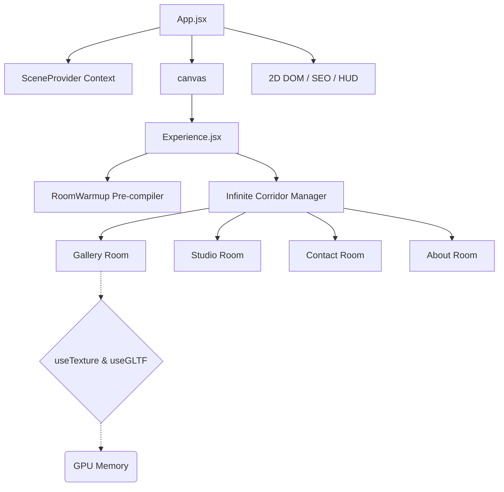

# 🎨 Subbulakshmi K | Interactive 3D Full Stack Developer Portfolio

<div align="center">
  
  
  
  
  
  
</div>

<br/>

Welcome to the interactive 3D Web Developer portfolio of **Subbulakshmi K**. Built with React 19, Three.js, React Three Fiber, and GSAP, this application showcases full-stack web engineering, applied machine learning systems, and AI-assisted workflows.

> [!NOTE]
> Ensure hardware acceleration is enabled in your browser settings to experience the smooth 60 FPS high-tier rendering of this application.

## 🚀 Key Performance Architectures (2026 Standards)

This application is strictly optimized for cross-device operability, achieving zero lag spikes even on mobile processors through several bespoke architectural implementations:

1. **Invisible Semantic SEO Fallback:** Bypasses WebGL canvas SEO limitations via strategic `sr-only-seo` indexing DOM injections, rendering fully visible semantic trees to native search-engine crawlers without mounting heavy bundles.
2. **Asynchronous Shader Compilation:** Enforces `gl.compileAsync` during the Preloading phase inside a hidden `RoomWarmup` Suspense boundary. This allows Three.js to pre-compile complex materials asynchronously without blocking the main React update thread.
3. **Baked Global Tinting & Lighing Extraction:** Replaced real-time WebGL shadow maps and infinite light rays with baked-in global textures (`apply_global_tint.js`), dropping the GPU compute overhead entirely while maintaining visual depth.
4. **DOM Mutation Bypassing:** Critical animation properties (like SVG preloader states tracking 130+ concurrent HTTP texture requests) write directly to the `ref.current.style`, intentionally bypassing React’s `setState` render cycles to conserve CPU.
5. **Adaptive Device Tiering:** Auto-detects `navigator.deviceMemory`, hardware concurrency, and viewport sizes to scale WebGL resolutions (`dpr`), antialiasing algorithms, and texture loading strictness on the fly.

---

## 🏗️ 3D Scene Architecture



---

## 🛠️ Local Development Setup

To run this application natively on your local machine:

1. **Clone the repository:**
   ```bash
   git clone https://github.com/TestLab-debug-sudo/shobi1.git
   cd shobi1
   ```

2. **Install dependencies:**
   Make sure you are on Node.js v20+.
   ```bash
   npm install
   ```

3. **Start the local Dev Server:**
   ```bash
   npm run dev
   ```

> [!IMPORTANT]
> Since this project heavily utilizes `vite-plugin-compression` and hundreds of high-res textures, your initial local load might take a few seconds as the dev-server buffers asset delivery. For performance testing, always run `npm run build && npm run preview`.

## 🤝 Contributing & Feedback

All PRs improving the shader physics, 3D math logic, or component memoization runtimes are welcome.

1. Fork the Project
2. Create your Feature Branch (`git checkout -b feature/AmazingFeature`)
3. Commit your Changes (`git commit -m 'feat: Add amazing feature'`)
4. Push to the Branch (`git push origin feature/AmazingFeature`)
5. Open a Pull Request

## License

The code in this repository is licensed under the [MIT License](LICENSE).  
**Note:** All personal assets, 3D textures, images, and copywriting are copyright of Subbulakshmi K.

---

*Designed and Developed by [Subbulakshmi K](https://protfoliomee.netlify.app/).*
